<p align="center">
  
</p>

<h1 align="center">pwauto</h1>

<p align="center">
  <strong>AI-agent-ready UI test automation for any web application.</strong><br>
  Playwright · TypeScript · BDD (Gherkin) · agents and skills for Claude Code and Codex
</p>

<p align="center">
  <a href="LICENSE"></a>
  <a href="https://nodejs.org"></a>
  <a href="https://playwright.dev"></a>
  <a href="https://www.typescriptlang.org"></a>
  <a href="https://vitalets.github.io/playwright-bdd/"></a>
  <a href="https://agentskills.io"></a>
</p>

<p align="center">
  <a href="#quick-start">Quick start</a> ·
  <a href="#how-it-works">How it works</a> ·
  <a href="#features">Features</a> ·
  <a href="#documentation">Documentation</a> ·
  <a href="#contributing">Contributing</a>
</p>

---

## About

pwauto is a scaffold for UI test automation. You give it the URL of a web application. AI agents then help you get BDD tests that people reviewed and that pass.

The agents do the technical work. Strict guardrails control what they can do. Testers and test analysts write and approve the scenarios in plain English. They do not need much coding experience.

**pwauto is for you if:**

- you test web applications and want automated UI tests without a large coding effort
- you want AI agents to help, but you want to keep control of what they test
- you want each expected result to come from documented business rules, not from the current output of the application

## How it works

The workflow goes through these stages. The agent stops after each stage and waits for your decision.

```text
  ┌────────┐   ┌─────────┐   ┌───────────┐   ┌────────┐   ┌──────────┐   ┌──────┐   ┌────────┐
  │ setup  │ → │ explore │ → │ scenarios │ → │ review │ → │ automate │ → │ heal │ → │ report │
  └────────┘   └─────────┘   └───────────┘   └────────┘   └──────────┘   └──────┘   └────────┘
```

| Stage | What happens | Result |
|---|---|---|
| **Setup** | The agent checks your computer and installs what pwauto needs. | A working project and `.env` file |
| **Explore** | The agent crawls the application with the Playwright CLI and records what it learns. | A knowledge base in `knowledge/` |
| **Scenarios** | The agent writes BDD scenarios from the knowledge base. | `@draft` feature files and a test plan |
| **Review** | The qestack review panel checks the scenarios. Then you approve them. | Approved scenarios |
| **Automate** | The agent writes page objects and step definitions. It runs the tests until they are stable. | Passing tests |
| **Heal** | The agent finds the cause of each failure. It fixes test bugs and records application bugs. | Fixes and bug reports |
| **Report** | The agent runs the suite and writes a summary in plain language. | HTML, Allure and Cucumber reports |

## Features

### Framework

- **Generic core** (`src/core`): typed configuration from `.env`, a base class for page objects, fixtures for logs, scenario context and test data.
- **Login by role**, with session reuse.
- **Evidence for each test:** screenshots, videos, traces, logs, console errors, and failed API calls with their response bodies.
- **Accessibility scans.**
- **Generic Gherkin steps** that work on any site, for example `When I click the "Sign in" button`. You can start without code. Run `npm run steps:list` to see all steps.

### AI agents

- **Agents and skills for each stage** in the open [Agent Skills](https://agentskills.io) format. They work in Claude Code, in Codex and in other agents that read `AGENTS.md` or `.agents/skills`.
- **Playwright CLI for agents** (`npx playwright cli`). Playwright includes it, so its version always matches. It uses few tokens and needs no MCP configuration.
- **Safe login.** You save a login session with `npm run auth:save`. The AI never sees a password.
- **Knowledge base as the test oracle.** Every expected result comes from a [domainlore](https://github.com/quark-sri/domainlore) knowledge base of the application.
- **Independent review** by the [qestack](https://github.com/quark-sri/qestack) panel of reviewer personas.

### Quality guardrails

- ESLint rules and an edit hook block sleeps, skipped tests, focused tests, XPath and calls without `await`.
- A guard stops changes that weaken a test, for example removed assertions or extra retries.
- Agents must never weaken a test to make it pass. When the application is wrong, the agent records a bug and keeps the assertion.

### Reports and CI

- Playwright HTML report with screenshots, video, trace, logs and a "fix with AI" prompt for each test.
- Allure, Cucumber HTML, JUnit and JSON reports.
- GitHub Actions workflow with sharding, artifacts and an Allure report.

## Quick start

### Prerequisites

- [Node.js 22 or 24 LTS](https://nodejs.org)
- [Git](https://git-scm.com)
- Optional: [Claude Code](https://claude.com/claude-code) or [Codex](https://github.com/openai/codex) to use the AI workflow

For details on Windows, macOS and Linux, read [Getting started](docs/01-getting-started.md).

### Install and run

1. Clone the repository and install it:

   ```bash
   git clone https://github.com/quark-sri/pwauto.git
   cd pwauto
   npm run setup
   ```

   `npm run setup` installs the packages and browsers, creates `.env` and checks your computer.

2. Run the tests. If `BASE_URL` is not set, this command runs the reference example:

   ```bash
   npm test
   ```

3. Open the HTML report:

   ```bash
   npm run report
   ```

4. Set the URL of your application and run its smoke tests:

   ```bash
   npm run env:set -- BASE_URL=https://your-app.example.com
   npm run test:smoke
   ```

### Use the AI workflow

Start an agent in the project folder and tell it what to automate:

```text
claude            # or: codex
> /pwauto  Automate https://my-app.example.com — start with login and search.
```

### Use pwauto without AI

1. Write scenarios with the generic steps in `features/app/`.
2. Run `npm test`.
3. Run `npm run report` to open the report.

```gherkin
Feature: Order history
  Scenario: A customer opens the order history
    Given I am logged in as a "customer"
    When I click the "Orders" link
    Then I should see the "My orders" heading
```

For more information, read [Writing BDD scenarios](docs/05-writing-bdd-scenarios.md).

## Commands

| Command | What it does |
|---|---|
| `npm run setup` | Installs everything and checks your computer. |
| `npm run doctor` | Checks your computer only. |
| `npm run env:set -- KEY=value` | Sets a value in `.env`. |
| `npm run auth:save -- --role <role>` | Saves a login session for a user role. |
| `npm test` | Runs all tests. |
| `npm run test:smoke` | Runs the `@smoke` tests. |
| `npm run test:example` | Runs the reference example. |
| `npm run steps:list` | Lists the generic steps. |
| `npm run report` | Opens the HTML report. |
| `npm run check` | Runs type checks, lint, the weakening guard, unit tests and skill checks. |

## Reference example

The folder `examples/toolshop/` contains a full example. It tests the public [Toolshop](https://practicesoftwaretesting.com) practice shop. It includes a knowledge base, scenarios, page objects, API data setup and steps. Copy its patterns for your application.

To run it, use `npm run test:example`. To remove it, use `npm run example:remove`.

## Project layout

```text
src/core/            generic engine (never app-specific)
src/steps/common/    generic steps for any site
src/app/             your app: page objects, steps, API clients, fixtures
features/app/        your scenarios (.feature)
knowledge/           your app's knowledge base (domainlore)
test-plan/           test plan, traceability, reviews, bug reports, run summary
examples/toolshop/   reference example
.claude/             agents, skills, settings, hook (.agents/skills = copy for other agents)
docs/                guides
```

## Documentation

| Guide | For |
|---|---|
| [Getting started](docs/01-getting-started.md) | Everyone. Install and do the first run. |
| [AI workflow](docs/02-ai-workflow.md) | Everyone. Stages, agents, skills and what to type. |
| [Architecture](docs/03-architecture.md) | Automation engineers and agents. |
| [Coding standards](docs/04-coding-standards.md) | Automation engineers and agents. |
| [Writing BDD scenarios](docs/05-writing-bdd-scenarios.md) | Test analysts. Gherkin, tags and generic steps. |
| [Configuration](docs/06-configuration.md) | Everyone. `.env`, environments, browsers and users. |
| [Reports and debugging](docs/07-reports-and-debugging.md) | Everyone. |
| [Test data and login](docs/08-test-data-and-auth.md) | Automation engineers. |
| [CI/CD](docs/09-ci-cd.md) | Leads and DevOps engineers. |
| [Troubleshooting](docs/10-troubleshooting.md) | Everyone. |
| [Research and design decisions](docs/11-research-and-design.md) | Leads and architects. |
| [Roadmap](docs/12-roadmap.md) | Everyone. |
| [Glossary](docs/glossary.md) | Everyone. |

## Contributing

Contributions are welcome. Read the [contributing guide](CONTRIBUTING.md) before you open a pull request. It tells you how to set up the project, which rules to follow and how to send a change.

To report a bug or ask for a feature, [open an issue](https://github.com/quark-sri/pwauto/issues).
## Security

Do not put secrets in commits, issues or logs. pwauto keeps credentials in `.env` and in saved sessions in `.auth/`. Git ignores both.

If you find a security problem, do not open a public issue. Report it privately to the maintainers through [GitHub security advisories](https://github.com/quark-sri/pwauto/security/advisories/new).

## Acknowledgements

pwauto is built on [Playwright](https://playwright.dev), [playwright-bdd](https://github.com/vitalets/playwright-bdd), [Allure Report](https://allurereport.org), [qestack](https://github.com/quark-sri/qestack) and [domainlore](https://github.com/quark-sri/domainlore).

## License

pwauto is licensed under the [Apache License 2.0](LICENSE).
