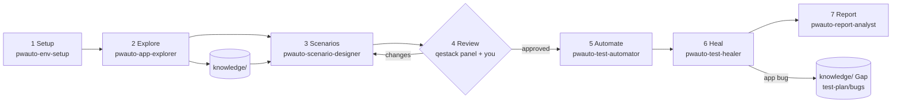

# 2. The AI workflow

pwauto splits test automation into seven stages. Each stage has one **skill** (the method, in `.claude/skills/<name>/SKILL.md`, copied to `.agents/skills/` for Codex and other agents) and, in Claude Code, one **agent** (a specialist with its own context that loads the skill). Every stage ends at a **gate**: the agent stops, shows you the result and waits for your decision.



## 2.1 The stages

| # | Stage | Ask the agent | It does | You get | Gate (you decide) |
|---|---|---|---|---|---|
| 1 | Setup | `/pwauto-setup` · "set up my machine" | Detects OS, CPU, RAM, Node, browsers; installs what is missing; configures `.env`, agent skills, plugins | doctor report, smoke test result | all ✅ |
| 2 | Explore | `/pwauto-explore https://app` · "learn the app" | Crawls links, then explores flows in a real browser (Playwright CLI); records actors, screens, journeys, rules, terms with sources | `knowledge/` pages, summary, open questions | is the summary right? answer questions |
| 3 | Scenarios | `/pwauto-scenarios checkout` · "write test cases for checkout" | Risk analysis, test design techniques, Gherkin with `@draft` | `features/app/<area>/*.feature`, `test-plan/test-plan.md`, `test-plan/traceability.md` | scope and priorities |
| 4 | Review | `/pwauto-review` · "review the scenarios" | Finds missing cases; runs the qestack review panel (independent reviewers, **no mutation testing**); proposes changes | `test-plan/reviews/<date>-scenarios/` | **approve** per feature; `@draft` removed |
| 5 | Automate | `/pwauto-automate` · "automate the approved scenarios" | Page objects, steps, API data setup; runs until green and stable (5 repeats) | code in `src/app/`, green run | — |
| 6 | Heal | `/pwauto-heal` · "the tests are failing" | Classifies each failure with evidence; fixes test bugs; records app bugs | fixed tests, `test-plan/bugs/`, Gap pages | confirm app bugs |
| 7 | Report | `/pwauto-report` · "run the regression and summarise" | Runs; writes a plain summary with evidence links | `test-plan/run-summary.md`, reports | — |

`/pwauto` runs the whole sequence: it checks which stage you are at and continues from there.
For framework changes (new setting, SSO login, CI, reporter) use `/pwauto-framework` (agent `pwauto-framework-architect`).

## 2.2 Example session (Claude Code)

```text
> /pwauto Automate https://shop.example.com. Login, search and checkout matter most.
  Stage 1 — your Mac (arm64, 24 GB) is ready; browsers installed. Smoke test passed.
  Before I explore: which roles exist, and may I place test orders on this environment?
> Roles: customer and admin. It is a QA environment, orders are fine.
  Please add CUSTOMER_USERNAME/PASSWORD and ADMIN_USERNAME/PASSWORD to .env yourself.
  Stage 2 — explored 34 pages and 6 flows. Areas: account, catalog, ordering, admin.
  Risky: payments (5 methods), billing address validation. 2 open questions … [summary]
> Looks right.
  Stage 3 — 31 scenarios in 6 feature files, all @draft. Uncovered: admin reports (out of scope?).
> Out of scope.
  Stage 4 — panel verdict: ready after fixes 1–4. Missing cases: 5 (boundary on quantity, …).
  [table of proposed changes]
> Approve all except #3. Add a case for an expired session at checkout.
  … applied; @draft removed from 5 files.
  Stage 5 — 32 scenarios automated, 30 pass, 2 fail.
  Stage 6 — 1 locator fixed (test bug). 1 application bug: discount not applied at exactly
  $100.00 (knowledge says ≥ $100). Recorded as Gap + bug report; scenario tagged @gap @fixme.
  Stage 7 — 31 passed, 1 fixme (known bug). Summary: test-plan/run-summary.md. Report: npm run report
```

## 2.3 Claude Code and Codex

| | Claude Code | OpenAI Codex (and other agents) |
|---|---|---|
| Instructions | `CLAUDE.md` (imports `AGENTS.md`) | `AGENTS.md` |
| Skills | `.claude/skills/` — run as `/pwauto-…` | `.agents/skills/` — "use the pwauto-explore skill" |
| Specialist agents | `.claude/agents/` (separate context per stage) | not needed: the main agent follows the skill |
| Browser for agents | `npx playwright cli` + skill `playwright-cli` | the same (no configuration) |
| Review panel | qestack plugin (enabled in `.claude/settings.json`) | qestack skills installed with `install-skills.sh --agent codex` |
| Guardrail hook | `scripts/hooks/check-edit.mjs` after each edit | run `npm run check` (the skills ask for it) |

Edit skills only in `.claude/skills/`. `npm install` (and `node scripts/sync-agent-skills.mjs`) copies them to `.agents/skills/`; CI fails if the copies differ.

## 2.4 The tools behind the agents

> **Why no MCP?** The tests run on Playwright Test alone. Agents need a browser only to explore, inspect elements and debug. Playwright's built-in CLI does that with shell commands and a skill: no MCP configuration, fewer tokens, version-matched with the project, and the same for every AI agent. See [design decisions](11-research-and-design.md).

| Tool | Used for | Why |
|---|---|---|
| `npm run explore` (crawler, `scripts/crawl.ts`) | site map, page inventory, accessibility snapshots, screenshots | cheap and safe: follows links only, no form submits; keeps the AI context small |
| Playwright CLI (`npx playwright cli`, skill `playwright-cli`) | interactive exploration, snapshots, locator generation | built into Playwright, version-matched, token-efficient, identical in Claude Code and Codex, no configuration |
| `npm run auth:save` | sessions for pages behind login | the script reads credentials; the agent only loads the saved session |
| Playwright trace CLI (`npx playwright trace`, skill `playwright-trace`) | debugging failures from `trace.zip` | actions, DOM snapshots, network and console without opening a browser |
| `lore` (domainlore) | build and validate `knowledge/` | sourced facts, Gaps, glossary, diagrams |
| qestack `test-review-panel` | independent review | eight specialist reviewer personas; pwauto selects five, never the Saboteur |
| ESLint + edit hook | guardrails | blocks sleeps, skips, XPath, un-awaited calls the moment they are written |

## 2.5 Rules every agent follows

From `AGENTS.md` (summary):

1. No secrets in files, logs or chat; `.env` is never read by agents (`npm run env:set` writes values, `npm run auth:save` creates login sessions).
2. Expected results come from `knowledge/`; an application bug is recorded, never "fixed" in the test.
3. No sleeps, skips, `force`, removed or widened assertions, extra retries to get green.
4. Steps → page objects; Then-steps assert; page objects never assert business results.
5. Every scenario creates its own data; scenarios run in any order and in parallel.
6. New scenarios stay `@draft` until you approve them.
7. Ask before real-world effects (orders, payments, emails, deletes) unless you confirmed a test environment.

## 2.6 Tips for good results

- Give the agent the **purpose and the risky parts** of the application; it explores better.
- Share requirement documents: put them in `docs/requirements/` (or anywhere) and add them as sources in `lore.toml`; the explorer records them as `intended` facts and flags differences with the app as Gaps.
- Review scenarios like a business person: *Would I accept the product if exactly these pass?*
- Keep sessions focused on one area; ask for one stage at a time when the app is large.
