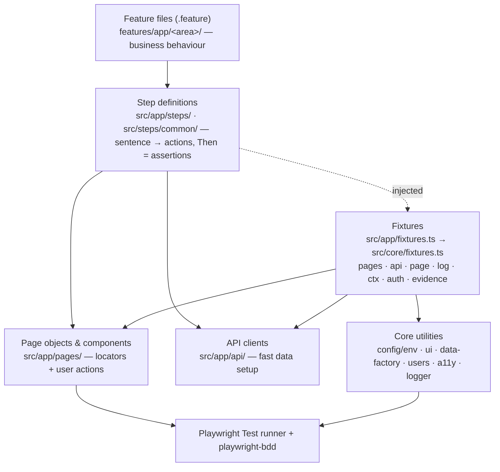
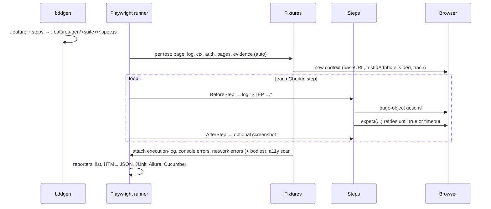

# 3. Architecture

## 3.1 Goals

1. **Any web application**: no application knowledge in the framework core; everything app-specific lives in `src/app/` (or a suite like `examples/toolshop/`).
2. **Readable by non-programmers**: behaviour in Gherkin; code hidden behind clear step sentences.
3. **Reliable**: user-facing locators, auto-waiting assertions, isolated data, no sleeps.
4. **Diagnosable**: every test leaves evidence (screenshots, video, trace, logs, failed API calls with bodies).
5. **AI-operable**: small, well-named layers, guardrails as code, and skills that encode the method.

## 3.2 Layers



| Layer | Knows about | Must not |
|---|---|---|
| Feature | business language | mention clicks, CSS, waits |
| Step | page objects, API clients, `expect` | hold locators or long logic |
| Page object | one page's locators and actions | assert business results, know other pages' internals |
| API client | backend endpoints for setup | drive the UI |
| Fixtures | how to build and clean up the above | contain test logic |
| Core | Playwright, configuration | know any application |

## 3.3 How a test runs



`npx bddgen` turns each scenario into a regular Playwright test, so every Playwright feature works: parallel workers, sharding, retries, projects per browser, trace viewer, UI mode.

## 3.4 Suites and projects

`playwright.config.ts` defines **suites**. Each suite has its own features, steps, base URL and options, and runs once per browser in `BROWSERS` as the project `<suite>-<browser>`:

| Suite | Features | Steps | URL | When |
|---|---|---|---|---|
| `app` | `features/**` | `src/steps/common`, `src/app` | `BASE_URL` | `BASE_URL` set |
| `toolshop` | `examples/toolshop/features` | `src/steps/common`, `examples/toolshop/steps` | its own | no `BASE_URL` yet, `INCLUDE_EXAMPLES=true`, or `npm run test:example` |

A second application in the same repository is a new suite (copy `examples/toolshop/suite.ts`). The example suite also serves as the regression test of the core.

## 3.5 Fixtures (dependency injection)

Steps receive what they need by name — they never construct objects themselves.

| Fixture | Scope | Provides |
|---|---|---|
| `page`, `context`, `request` | test | Playwright built-ins |
| `pages` | test | lazy registry: `pages.login`, `pages.cart` … created on first use (`definePages(registry)`) |
| `api` (example) | test | API client for data setup |
| `log` | test | logger; attached as `execution-log.txt` |
| `ctx` | test | scenario context: `ctx.set('order', o)` / `ctx.get('order')` |
| `auth` | test | `loginAs(role)`, `loginWith(credentials)`; session cached per worker |
| `evidence` | test, automatic | console errors, page errors, failed requests with response bodies, optional a11y scan |
| `sessionCache` | worker | storage states per user |
| `login`, `defaultUsers` | option | login form description and fallback users, per suite |

## 3.6 Design principles

| Principle | How it shows |
|---|---|
| **S**ingle responsibility | one page object per page; one step file per area; `env.ts` only config; `logger.ts` only logging |
| **O**pen/closed | new pages, steps, suites and fixtures are added without editing the core (`definePages`, `test.extend`, `suites`) |
| **L**iskov | every page object honours `BasePage` (`open`, `waitUntilReady`) |
| **I**nterface segregation | small fixture interfaces (`Auth`, `ScenarioContext`) instead of a "World" god object |
| **D**ependency inversion | steps depend on fixtures, not on `new SomePage(page)` |
| **DRY** | components for repeated UI (header, notifications), generic steps, data builders, one config schema |
| **KISS** | no custom runner, no wrappers around Playwright APIs that hide what happens |
| **Fail fast** | invalid config stops before the browser starts; missing steps fail at generation with snippets |
| **Secure by default** | secrets only in `.env`/CI, redacted in logs, agents log in through `npm run auth:save` and never see passwords |

## 3.7 Folder reference

```text
.
├── AGENTS.md / CLAUDE.md          agent instructions
├── .claude/                       agents/, skills/, settings.json (plugins, permissions, hook)
├── .agents/                       skills/ (copy for Codex & others), qa-project-context.md
├── playwright.config.ts           suites × browsers, reporters, evidence settings
├── .env.example                   every setting, documented
├── src/
│   ├── core/                      generic engine
│   │   ├── config/env.ts          typed, validated settings (zod)
│   │   ├── fixtures.ts            core fixtures + Given/When/Then + definePages
│   │   ├── ui.ts                  field/button/link/clickable lookup by visible text
│   │   ├── pages/BasePage.ts
│   │   └── utils/                 logger, users, data-factory, a11y
│   ├── steps/common/              generic steps (navigation, interaction, assertion, hooks)
│   └── app/                       YOUR application: pages/, steps/, api/, fixtures.ts
├── features/app/                  YOUR .feature files
├── knowledge/ + lore.toml         YOUR application's knowledge base (domainlore)
├── test-plan/                     test plan, traceability, reviews/, bugs/, run-summary.md
├── examples/toolshop/             full worked example (suite, pages, api, steps, features, knowledge)
├── scripts/                       doctor, setup, crawl, env-set, sync-agent-skills, remove-example, hooks/
├── docs/                          these guides
└── .github/workflows/ui-tests.yml CI
```
