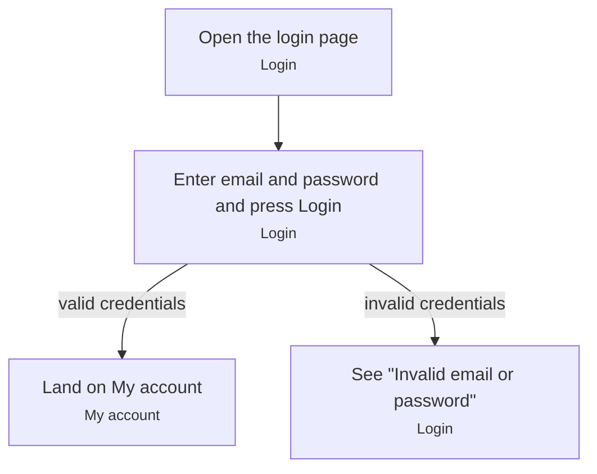

# Sign in

A valid sign-in redirects to `/account`. Unknown email or wrong password shows "Invalid email or password" and stays on the login page.[^explore]

[^explore]: Interactive exploration session with Playwright (2026-11-12)

<!-- generated:start flow -->
## Flow

<!-- generated:end flow -->

<!-- generated:start relations -->
## Relations

- [Customer](/account/actors/customer.md) performs this _(actual)_
- [Login](/account/screens/login.md) step of this _(actual)_
- [My account](/account/screens/my-account.md) step of this _(actual)_
<!-- generated:end relations -->
