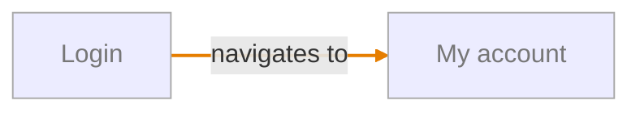

# Account map

Customers sign in, sign out and manage their account

## Navigation

_Legend: dashed arrow = intended only (not seen in app or code) · orange arrow = actual only (not specified) · red ⚠ = open Gap · grey = unverified._
