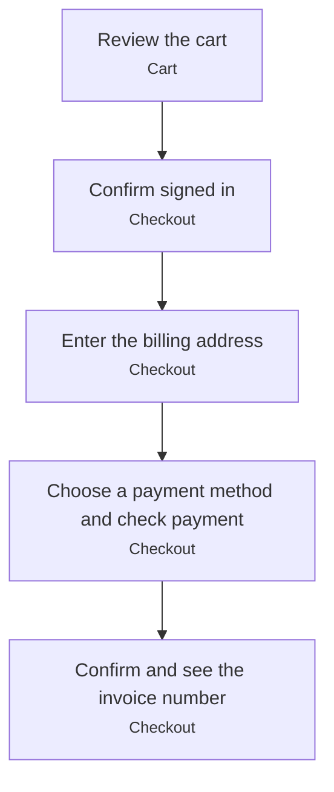

# Checkout

Four steps: Cart → Sign in → Billing Address → Payment.[^explore]

[^explore]: Interactive exploration session with Playwright (2026-11-12)

<!-- generated:start flow -->
## Flow

<!-- generated:end flow -->

<!-- generated:start relations -->
## Relations

- [Customer](/account/actors/customer.md) performs this _(actual)_
- [Cart](/ordering/screens/cart.md) step of this _(actual)_
- [Checkout](/ordering/screens/checkout.md) step of this _(actual)_
<!-- generated:end relations -->
