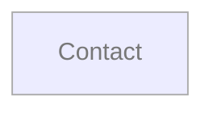

# Support map

Visitors contact the shop with questions

## Navigation

_Legend: dashed arrow = intended only (not seen in app or code) · orange arrow = actual only (not specified) · red ⚠ = open Gap · grey = unverified._
