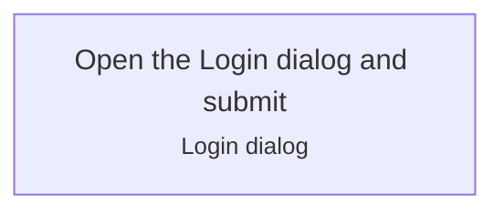

# Try login

Only the negative case was explored (unknown user, fake password). The positive case needs a test user.[^explore]

[^explore]: Interactive exploration session with Playwright (2026-11-21)

<!-- generated:start flow -->
## Flow

<!-- generated:end flow -->

<!-- generated:start relations -->
## Relations

- [Visitor](/account/actors/visitor.md) performs this _(actual)_
- [Login dialog](/account/screens/login-dialog.md) step of this _(actual)_
<!-- generated:end relations -->
