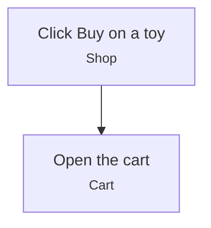

# Buy toys

Visitor opens "Shop", clicks "Buy" on a toy (once per unit), then follows "Cart (N)". Continues in [Checkout](../../ordering/journeys/checkout.md).[^explore]

[^explore]: Interactive exploration session with Playwright (2026-11-21)

<!-- generated:start flow -->
## Flow

<!-- generated:end flow -->

<!-- generated:start relations -->
## Relations

- [Visitor](/account/actors/visitor.md) performs this _(actual)_
- [Shop](/catalog/screens/shop.md) step of this _(actual)_
- [Cart](/ordering/screens/cart.md) step of this
<!-- generated:end relations -->
