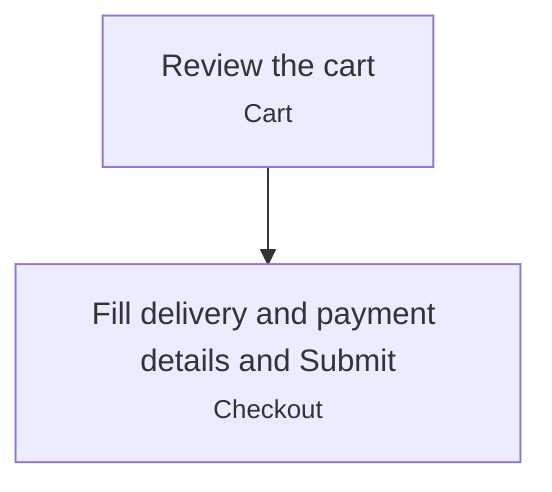

# Checkout

Cart, then the checkout form, then the confirmation with the order number. No real payment exists in this test environment (user statement).[^explore]

[^explore]: Interactive exploration session with Playwright (2026-11-21)

<!-- generated:start flow -->
## Flow

<!-- generated:end flow -->

<!-- generated:start relations -->
## Relations

- [Visitor](/account/actors/visitor.md) performs this _(actual)_
- [Cart](/ordering/screens/cart.md) step of this _(actual)_
- [Checkout](/ordering/screens/checkout.md) step of this _(actual)_
<!-- generated:end relations -->
