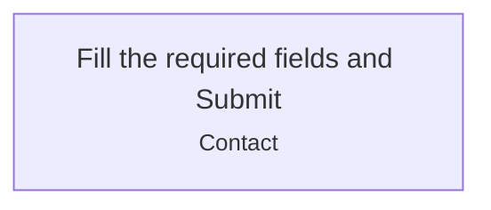

# Send feedback

Fill Forename, Email and Message, click "Submit". The form is replaced by "Thanks Test, we appreciate your feedback." (name from Forename) and a link "« Back".[^explore]

[^explore]: Interactive exploration session with Playwright (2026-11-21)

<!-- generated:start flow -->
## Flow

<!-- generated:end flow -->

<!-- generated:start relations -->
## Relations

- [Visitor](/account/actors/visitor.md) performs this _(actual)_
- [Contact](/support/screens/contact.md) step of this _(actual)_
<!-- generated:end relations -->
